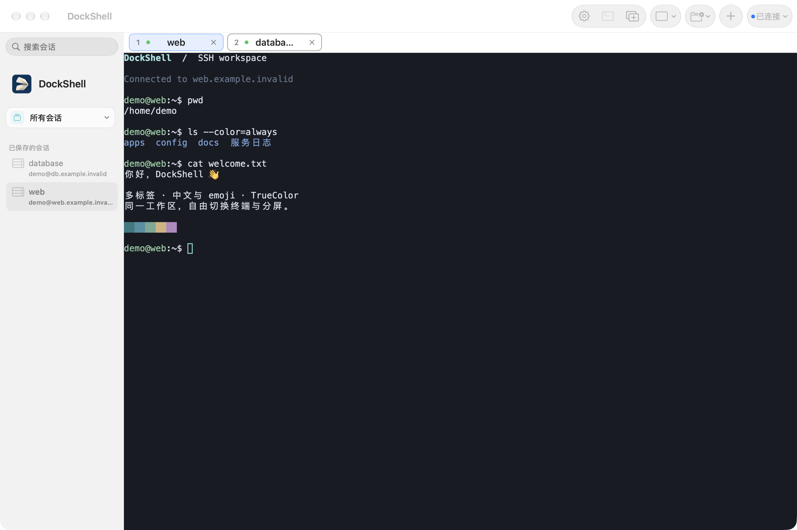
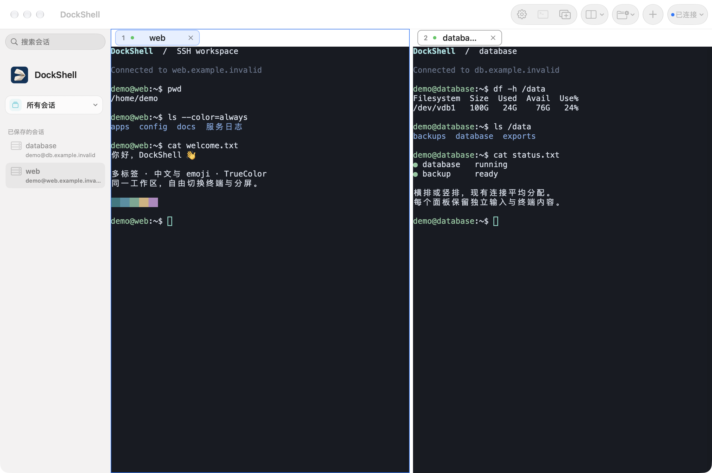

<p align="center">
  
</p>

<h1 align="center">DockShell</h1>

<p align="center">为 macOS 打造的原生 SSH 终端客户端</p>
<p align="center">多标签 · 横排 / 竖排分屏 · 本机 Shell · Keychain 凭据管理</p>

DockShell 使用 Swift、SwiftUI 和 AppKit 构建，让已保存的 SSH 会话、终端标签与分屏工作区集中在一个窗口中。终端模拟采用 SwiftTerm，SSH 连接通过系统 OpenSSH 与独立协议层适配。

**当前版本：0.1.0 / build 16，开发预览。** 目前通过源码构建运行，尚未发布经过 Developer ID 签名和公证的安装包。

[功能介绍](#功能介绍) · [界面预览](#界面预览) · [安装与启动](#安装与启动) · [使用指南](#使用指南) · [开发与验证](#开发与验证)

## 功能介绍

| 功能 | 当前支持 |
|---|---|
| 会话管理 | 新建、编辑、删除、分组和搜索，双击已保存会话即可连接 |
| SSH 认证 | 密码、外部私钥及本机 ssh-agent |
| 终端工作区 | 多标签、从 1 开始的编号、拖动排序、独立关闭 |
| 横排 / 竖排 | 将全部已打开连接平均排成一行或一列，保留原连接和终端内容 |
| 终端显示 | 256 色、TrueColor、鼠标、窗口尺寸同步，中文与 emoji 显示 |
| 本机终端 | 当前用户的默认交互式登录 Shell，从用户主目录启动 |
| 连接恢复 | 连接状态、协议心跳、断线提示与手动重连 |
| 主机信任 | 首次连接确认 SHA-256 指纹，保存主机记录，主机密钥变化时停止连接 |
| 凭据存储 | 会话配置存入 SQLite；保存的密码和私钥口令存入 Keychain |
| 个性化 | 字体、字号、三套终端主题，可调整的滚屏历史 |
| 本地化 | 简体中文与英文 |

## 界面预览

以下截图来自当前应用工作区的真实渲染，使用演示会话与示例终端输出。

### 多标签工作区

会话集中在侧栏；标签显示编号、连接状态和会话名称，可拖动排序。



### 横排分屏

将已打开的连接并排显示，各终端平均分配宽度；也可切换为上下堆叠的竖排布局。



## 安装与启动

### 环境要求

- **运行目标：macOS 14 或更高版本。** 当前主要在 Apple Silicon 上验证；macOS 14 实机与 Intel 运行仍待验收。
- **构建工具：Swift 6 工具链与 macOS SDK。** 当前已验证 Swift 6.4、SDK 27.0 的 Command Line Tools 环境。
- **首次构建需要网络**，用于 Swift Package Manager 下载锁定的依赖。

可使用 Command Line Tools 构建，**无需安装完整 Xcode，也无需登录 Apple Account**。如果尚未安装命令行工具，先执行：

```sh
xcode-select --install
```

确认 `xcrun swift --version` 显示 Swift 6；较旧的系统命令行工具可能需要更新。

### 从源码运行

```sh
git clone https://github.com/SunHarvey/dockshell.git
cd dockshell

sh Scripts/check-environment.sh
sh Scripts/run.sh zh-Hans
```

运行脚本会编译项目、生成双语资源、组装 `.app`、进行本地临时签名并启动应用。生成的应用位于 `Build/debug/DockShell.app`。

英文界面或跟随系统语言：

```sh
sh Scripts/run.sh en
sh Scripts/run.sh
```

重新构建或更换语言前，请先用 **⌘Q** 退出已运行的 DockShell。语言参数只影响本次启动。

### 只构建应用

```sh
sh Scripts/build.sh
open Build/debug/DockShell.app
```

需要 Release 构建时：

```sh
sh Scripts/build.sh release
open Build/release/DockShell.app
```

请启动打包后的 `.app`。构建脚本负责组装终端与本地化资源，直接 `swift run DockShell` 不完成这一步。

## 使用指南

### 连接服务器

1. 点击 **新建会话**，填写名称、主机、端口、用户名和认证方式。
2. 保存后双击侧栏会话，或选中会话后使用工具栏连接按钮 / **⌘T**。
3. 首次连接时，独立核对服务器的 **SHA-256 主机指纹**，确认后继续认证。
4. 需要保存密码时，在编辑会话中勾选保存到钥匙串；连接时临时输入的密码或口令不会自动保存。

私钥保留在用户选择的外部文件中。支持已识别的 OpenSSH 私钥和部分旧式 PEM 封装；PuTTY `.ppk` 需要先转换为 OpenSSH。具体格式范围见 [私钥与 ssh-agent 说明](Docs/M5/私钥Agent与连接恢复.md)。

ssh-agent 认证复用当前用户已有的 agent，密钥需事先加载；DockShell 不会自动载入或解锁 agent 中的密钥。

### 管理标签与分屏

- 每个标签对应一条独立连接，同一已保存会话可以打开多个标签。
- 拖动标签调整顺序，编号会按当前顺序重新从 1 排列；点击 **×** 只关闭对应连接。
- 打开至少两个连接后，在工具栏 **终端布局** 中选择 **横排（左右并列）** 或 **竖排（上下堆叠）**。
- 分屏使用全部已打开连接，不会额外创建连接。三个连接就是等宽的三列或等高的三行。
- 点击目标终端或标签切换输入焦点，选择 **标签视图** 可返回普通标签切换。
- 断线后可通过右上角连接状态菜单手动重连。

### 使用本机终端与设置

关闭全部远程标签后，点击 **打开本机终端**，即可使用当前用户的默认 Shell。初始目录为用户主目录，可以执行 `pwd`、`ls`、`top` 等本机命令；输入 `exit` 退出后可重新打开。

通过齿轮按钮或 **⌘,** 打开设置：

- 选择字体、字号与终端配色主题。
- 滚屏历史默认 **10000 行**，可设置为 1000–100000 行。
- 连接期间的字体与字号调整在下一次连接 / 重新打开 Shell 时生效；配色和历史上限即时生效。

## 当前进度

当前已实现会话管理、SSH 连接、终端、多标签、横排 / 竖排和本机 Shell。**SFTP 文件面板、端口转发、跳板机、批量输入、快速命令、日志、Zmodem 和配置导入仍在后续规划中。**

中文与 emoji 的显示已有验证；完整真实中文输入法候选交互、实际睡眠唤醒、保存密码后的最终包重启登录、macOS 14 实机及正式分发签名 / 公证仍有人工待验项。详细边界见 [验收记录](Docs/M6/验收矩阵.md)。

## 开发与验证

```sh
sh Scripts/test.sh
```

在具有图形桌面的会话中运行原生界面检查：

```sh
DOCKSHELL_UI_SMOKE=1 sh Scripts/test.sh
```

默认验证使用隔离的临时数据与合成连接，覆盖凭据隔离、真实本地 PTY、背压、生命周期、标签与分屏、资源打包和应用搬迁。真实服务器、性能及 Keychain 重启集成的专项入口见 [性能与交付记录](Docs/M6/性能与交付记录.md)。

### GitHub Actions

`CI` 在提交到 `main`、向 `main` 创建 PR 或手动运行时进行编译和默认验证。`Draft Release` 可手动针对已推送的版本标签构建 **Apple Silicon / arm64** 预览包，上传 ZIP 与 SHA-256 校验文件，并创建未公开的草稿 Pre-release。目前产物仍采用 ad-hoc 签名，未经过 Apple 公证；工作流不自动公开发布。操作步骤、版本规则和完整文件见 [GitHub Actions 构建与草稿发布](Docs/GitHub-Actions.md)。

### 项目结构

```text
DockShellApp/             应用入口与依赖组装
Packages/DockShellKit/    业务、协议、基础设施与原生终端界面
Localization/            简体中文与英文 String Catalog
Packaging/               应用信息、图标与分发资源
Scripts/                 构建、运行、验证与打包脚本
Tools/                   资源编译、辅助程序与验证工具
Docs/                    架构、开发与验收文档
M0/                      SSH 底层路线的独立技术验证
```

### 主要依赖

| 组件 | 版本 / 来源 |
|---|---|
| [SwiftTerm](https://github.com/migueldeicaza/SwiftTerm) | 固定 **1.19.0**，通过 Swift Package Manager 集成 |
| OpenSSH | macOS 自带的系统工具，通过自有协议和 PTY 适配 |
| SQLite | macOS 系统库 |
| [ArgumentParser](https://github.com/apple/swift-argument-parser) | 上游解析依赖 **1.8.2**，不链接进应用 |

M0 中的 Citadel / libssh2 探针与正式应用依赖相互独立。随应用分发的第三方声明见 [ThirdPartyNotices](Packaging/ThirdPartyNotices.txt)。

## 更多文档

- [GitHub Actions 构建与草稿发布](Docs/GitHub-Actions.md)
- [开发过程与版本调整记录](Docs/Development-History.md)
- [横排与竖排工作区](Docs/M8/横排与竖排.md)
- [私钥、ssh-agent 与连接恢复](Docs/M5/私钥Agent与连接恢复.md)
- [分发、签名与公证准备](Docs/M6/分发准备.md)
- [不安装完整 Xcode 的构建方案](Docs/不安装Xcode的构建方案.md)
- [M0 技术验证与 SSH 路线对比](Docs/M0/SSH底层路线对比.md)
