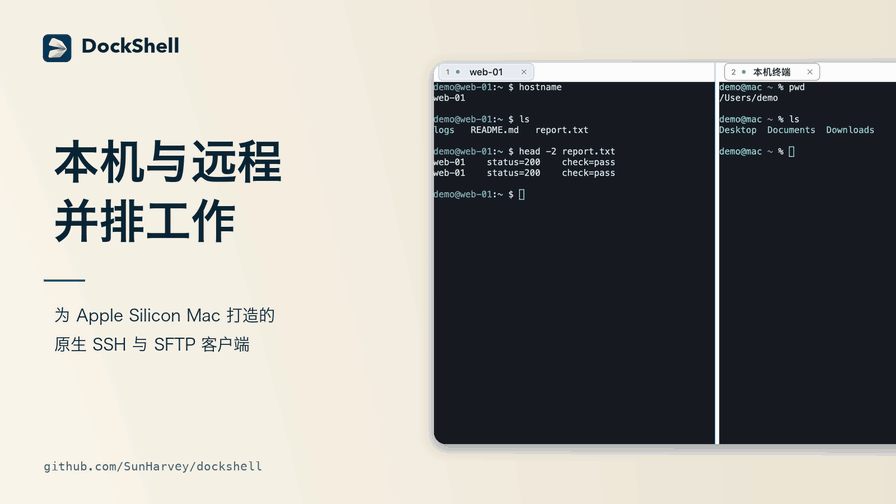
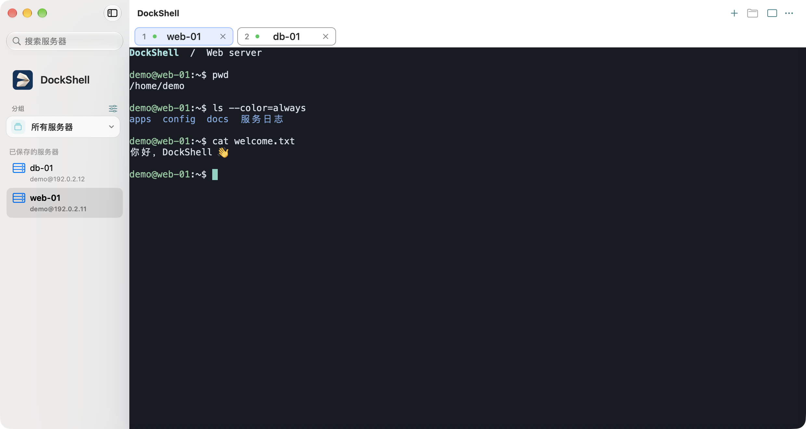
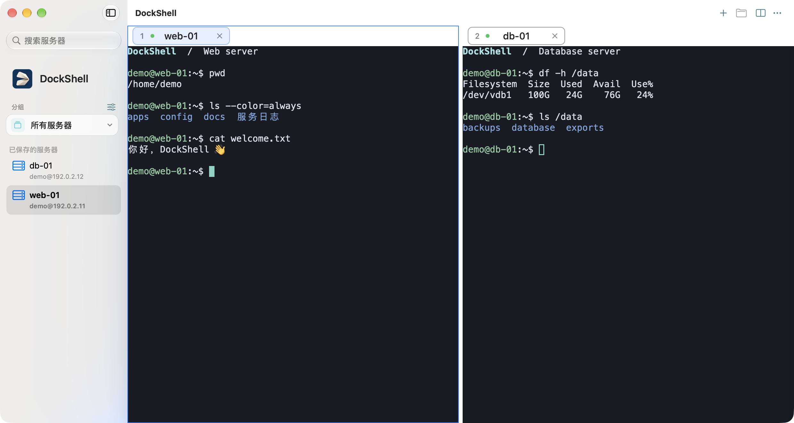

<p align="center">
  
</p>

<h1 align="center">DockShell</h1>

<p align="center">Apple Silicon Mac 上的原生 SSH 与 SFTP 客户端，支持简体中文和英文。</p>

导入已有的 `~/.ssh/config`，在同一窗口并排使用本机 Shell 和远程终端，或从右侧文件面板上传、下载文件。

**[下载 v0.4.5 · Apple Silicon DMG](https://github.com/SunHarvey/dockshell/releases/download/v0.4.5/DockShell-0.4.5-arm64.dmg)** · [发布说明](https://github.com/SunHarvey/dockshell/releases/tag/v0.4.5) · [安装](#安装) · [功能](#功能) · [使用](#使用) · [从源码运行](#从源码运行)

## 30 秒演示

[](Docs/Images/dockshell-demo-zh-Hans.mp4?raw=true)

[下载高清演示 MP4（30 秒，约 5.7 MB，中文字幕）](Docs/Images/dockshell-demo-zh-Hans.mp4?raw=true)

<details>
<summary>查看多标签与分屏的静态截图（随 v0.4.3 发布）</summary>

### 多标签工作区



### 左右并列分屏



</details>

## 安装

适用于 **Apple Silicon（arm64）、macOS 14 或更高版本**。macOS 14 实机仍待验证。

1. 在最新 Release 的 **Assets** 中下载以 `-arm64.dmg` 结尾的安装包。[前往 Releases](https://github.com/SunHarvey/dockshell/releases/latest)
2. 打开 DMG，将 **DockShell.app** 拖到 **Applications（应用程序）**。复制完成后推出磁盘映像，从「应用程序」启动 DockShell。

当前安装包采用 ad-hoc 签名，尚未获得 Developer ID 签名和 Apple 公证。如果首次启动提示 Apple 无法验证 DockShell，请先确认下载来源。确认信任该版本后，可在「系统设置 → 隐私与安全性」中选择「仍要打开」。[Apple 的首次打开说明](https://support.apple.com/zh-cn/102445)

如需校验 DMG，将同一 Release 的 `SHA256SUMS` 和安装包放在同一目录，在该目录运行：

```sh
shasum -a 256 -c SHA256SUMS
```

## 功能

| 功能 | 支持范围 |
|---|---|
| 服务器管理 | 新建、编辑、删除、分组、搜索，双击服务器连接 |
| SSH 配置导入 | 默认读取 `~/.ssh/config`，可选择文件；预览编辑后导入指定分组 |
| CSV 批量创建 | 文件或粘贴输入，支持密码、私钥、ssh-agent 三种认证配置；同组同名跳过 |
| SSH 认证 | 密码、文件或粘贴私钥、本机 ssh-agent；密码和私钥口令可保存到 Keychain |
| 多标签与分屏 | 标签编号、拖动排序、独立关闭。本机与远程标签可左右并列或上下堆叠，空间平均分配 |
| 终端 | 256 色、TrueColor、鼠标、窗口尺寸同步、中文与 emoji 显示 |
| SFTP | 右侧可收起面板，远程目录浏览、文件多选上传下载、进度、取消与传输队列 |
| 批量命令 | 独立命令栏，将单行命令发送到全部已连接 SSH 标签，显示排队与跳过明细 |
| 终端日志 | 默认记录，每连接保留最近 5 MB；容量可调，右键暂停、开始、导出或复制，重新开始后读取新一轮日志 |
| 连接与信任 | 首次主机指纹确认、主机密钥变化拦截、心跳检测、断线提示，Enter 或鼠标重连 |
| 本机 Shell | 从主目录打开独立的本机 Shell，可与 SSH 标签同时打开和分屏 |
| 设置 | 字体、字号、三套主题、滚屏历史和日志设置，保存后立即作用于已打开终端 |

## 使用

### 创建与连接服务器

点击 macOS 菜单栏的 **服务器 → 新建服务器**（⌘N），填写名称、主机、端口和用户名，并选择认证方式。保存后双击侧栏服务器，或选中后按 **⌘T** 连接。DockShell 单独保存已信任的主机密钥。即使此前用命令行连接过，首次在 DockShell 连接时也要核对 SHA-256 指纹。

点击侧栏「分组」右侧的按钮可管理分组。删除分组后，其中的服务器会移到「未分组」。

私钥可以选择外部文件或直接粘贴。选择文件时，DockShell 保存对原文件的引用。粘贴时，DockShell 将私钥保存为仅当前用户可读写的托管文件，保留原有加密状态。支持 OpenSSH 和部分 PEM 私钥，PuTTY `.ppk` 需先转换。[私钥输入与存储说明](Docs/会话认证输入.md)

密码和私钥口令都可按需保存到 macOS 钥匙串。勾选保存后，输入框旁的眼睛可查看或隐藏本次输入。连接时临时输入的密码或口令只用于本次认证。密码认证使用 SSH 的 `password` 方式，暂不支持仅提供 `keyboard-interactive` 的服务器。

使用 ssh-agent 前，先检查本机 agent 已加载的密钥。若列表里缺少目标密钥，再按实际路径加载，例如：

```sh
ssh-add -l
ssh-add ~/.ssh/id_ed25519   # 按需执行，替换为自己的私钥路径
```

随后选择 **SSH agent** 认证。DockShell 复用本机已有的 agent，不自动加载或解锁密钥。

### 导入 SSH 配置

选择 **服务器 → 导入 SSH 配置…**，默认读取 `~/.ssh/config`，也可选择其他文件。默认目标分组为 `local-ssh-config`，支持选择已有分组或填写新名称。

展开预览中的「连接详情」可编辑配置，然后勾选要导入的服务器。同组同名条目会跳过，改名后可导入。导入会保存当时的配置，以后修改 `~/.ssh/config` 不会自动更新已保存的服务器。

`Host` 通配规则用于补全具体主机，`Include` 支持递归和文件名通配。读取的配置中只要出现 `Match`，本次所有候选服务器都会被阻止导入。使用跳板机或代理命令的条目也会标出并跳过。[完整支持范围](Docs/M12/SSH配置导入.md)

### CSV 批量创建

选择 **服务器 → CSV 批量创建服务器…**。选择 CSV 文件后会自动进入预览。直接粘贴内容时，点击 **预览服务器**。确认导入前可选择目标分组，默认为 `csv-import`。

```csv
name,host,port,username,auth,key_path
web-01,192.0.2.11,22,root,agent,
app-01,192.0.2.12,2222,admin,password,
db-01,192.0.2.13,22,ubuntu,key,~/.ssh/id_ed25519
```

表头必需列为 `name`、`host`、`username`、`auth`。`auth` 可填 `agent`、`password` 或 `key`。端口默认 22，使用 `key` 的行需要有效的本机私钥路径，支持绝对路径和 `~/`。**CSV 不填写密码或私钥口令**，连接时再输入。预览可修改名称和连接信息，只有已勾选且有效的行会导入。同组及批内重名会跳过并显示明细。

支持 UTF-8 CSV，最多 1000 台服务器、2 MB。含逗号的字段用双引号包围。导入不会自动连接，也不会覆盖已有服务器。[格式说明](Docs/M12/CSV批量创建.md) · [示例文件](Examples/servers.csv)

### 标签、分屏与工具栏

首页中央可直接打开已保存的服务器或本机终端。

- **＋** 打开本机终端或连接已保存的服务器。普通标签视图可用标签栏末尾或右上角的「＋」，分屏时用右上角的「＋」。菜单按分组展开服务器，未分组的服务器直接列出。首页右上角的「＋」也可新建和导入服务器。
- **文件夹** 展开或收起当前 SSH 标签的远程文件面板。
- **布局** 打开至少两个标签后，可将已有终端左右并列、上下堆叠，或切回普通标签视图。本机和远程终端都可以参与分屏。
- **⋯** 打开设置、连接操作和批量命令。将鼠标停在工具栏按钮上可查看用途。

每个本机终端都从用户主目录启动独立的登录 Shell，可以运行 `ls`、`top` 等命令。执行 `exit` 后可在原标签点击「重新打开」。拖动标签可排序，编号随之更新。点击 **×** 只关闭对应标签。

网络恢复后，在断线终端内按 **Enter** 或点击 **重新连接**，会沿用该标签打开时的服务器配置，重新认证并打开新的远程 Shell。如果已修改服务器地址或认证方式，请从侧栏重新打开服务器。睡眠唤醒后，DockShell 通过心跳检测断线。[连接恢复说明](Docs/M5/私钥Agent与连接恢复.md)

### SFTP 文件传输

连接 SSH 后，点击工具栏的文件夹按钮打开右侧面板。每个 SSH 标签保留各自的浏览目录。双击目录或在路径栏输入远程路径。「筛选当前目录」按名称筛选远程列表，旁边的眼睛菜单可显示隐藏文件。

- **上传**时先进入远程目标目录，点击「上传」并选择本机文件。
- **下载**时选中一个或多个远程普通文件，点击「下载」并选择本机目标目录。选区内如有目录或符号链接，下载按钮会变灰。

上传遇到同名普通文件时，若服务器支持安全替换，DockShell 会自动覆盖，否则会提示错误。重复下载会保留本机已有文件，例如再次下载 `report.txt` 会保存为 `report (1).txt`。

每个 SSH 标签的传输队列依次处理文件。收起面板后传输会继续。如果正在传输的任务被取消或失败，余下任务会暂停，点击 **继续队列** 可处理下一项。目录浏览和传输使用独立连接，未保存的密码或口令可能需要再次输入。当前仅支持普通文件，暂不支持断点续传和退出后恢复队列。[SFTP 使用说明](Docs/M9/SFTP文件传输.md)

### 批量命令、日志与设置

通过 **⋯ → 批量执行命令** 打开命令栏。按回车或点击 **执行到全部**，会将一行文字和一次回车发送到每个已连接的 SSH 标签，包括后台标签和同一服务器的多个连接。本机终端以及连接中、断线或正在等待 DockShell 认证的标签会跳过。

输入由各远端终端的前台程序接收。如果某个标签正在运行 vim 或停在 `sudo` 密码提示，它也会收到这行文字。发送结果中的「已排队」表示文字已进入本机发送队列，执行结果请查看相应终端。[批量命令说明](Docs/M11/批量命令.md)

SSH 与本机终端默认记录输出，每次连接最多保留最近 **5 MB**，超限会滚动删除较早内容。在设置里可统一开关「自动记录终端输出」，在终端内右键则可暂停或开始当前连接的记录，也可导出或复制。暂停后重新开始，导出和复制只包含新一轮日志。要保留断线前的记录，请在重连或关闭标签前导出。vim 等程序进入备用屏幕时只记进出时间。终端里回显的敏感内容也可能写入日志。[终端日志说明](Docs/M10/终端日志接入与验收.md)

通过 **⋯ → 设置** 或 **⌘,** 调整字体、字号、主题、滚屏历史和日志容量，保存后立即生效。滚屏历史默认 **10000 行**；日志容量可设为 **1–100 MB**。

## 从源码运行

源码构建需要支持 Swift 6 的 **Command Line Tools for Xcode** 和 macOS SDK。首次设置开发环境时，在 Apple Silicon Mac 上运行以下命令，按系统提示完成安装。

```sh
xcode-select --install
```

工具链就绪后，克隆仓库并启动中文版。

```sh
git clone https://github.com/SunHarvey/dockshell.git
cd dockshell
sh Scripts/run.sh zh-Hans
```

使用 `sh Scripts/run.sh en` 启动英文界面，或 `sh Scripts/run.sh` 跟随系统语言。重新构建前先用 **⌘Q** 退出旧应用。运行脚本负责资源打包与本地签名，生成 `Build/debug/DockShell.app`。

启动脚本会先检查工具链，再按需构建应用、SSH 辅助程序和资源编译器。验证工具由测试脚本单独构建。部分 CLT 版本会提示 `--build-system native` 已弃用。

## 开发与验证

SwiftUI / AppKit、MVVM 分层、async/await / Actor；协议层通过接口隔离，配置使用系统 SQLite，密码和口令使用 Keychain。

| 检查 | 命令 |
|---|---|
| 构建应用 | `sh Scripts/build.sh` 或 `sh Scripts/build.sh release` |
| 默认回归与资源搬迁 | `sh Scripts/test.sh` |
| 原生界面 | `DOCKSHELL_UI_SMOKE=1 sh Scripts/test.sh` |
| SSH 配置导入 | `sh Scripts/test-server-import.sh` |
| CSV 批量创建 | `sh Scripts/test-csv-import.sh` |
| SSH / SFTP 隔离集成 | `sh Scripts/test-sftp.sh` |

其他专项与验收边界见 [开发记录](Docs/Development-History.md)。CI 对 main / PR 执行构建与验证；版本标签触发 Release 工作流，标题使用标签本身，DMG 直接附在 Assets。[GitHub Actions 说明](Docs/GitHub-Actions.md)

| 组件 | 版本 / 来源 |
|---|---|
| [SwiftTerm](https://github.com/migueldeicaza/SwiftTerm) | **1.19.0+dockshell.2**，本地 SPM 包；[上游来源与本地补丁](Vendor/SwiftTerm/UPSTREAM.md) |
| OpenSSH | macOS 系统工具，通过自有协议与 PTY 适配 |
| SQLite | macOS 系统库 |

[第三方组件及许可证声明](Packaging/ThirdPartyNotices.txt)

## 后续计划

文件夹递归传输、端口转发、跳板机、快速命令、Zmodem 与 Xshell 配置导入尚未实现。平台与人工待验项见 [验收记录](Docs/M6/验收矩阵.md)，历史里程碑保留在 [开发记录](Docs/Development-History.md)。
