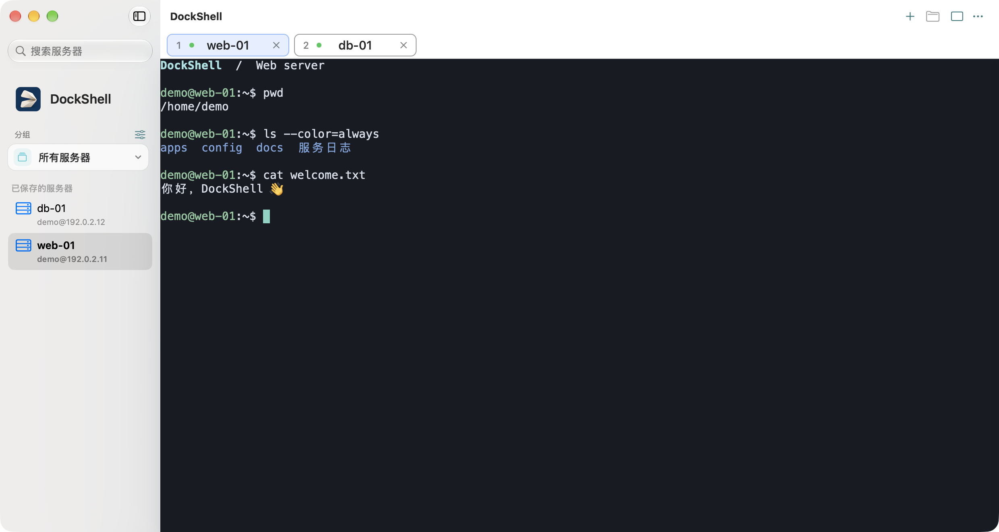
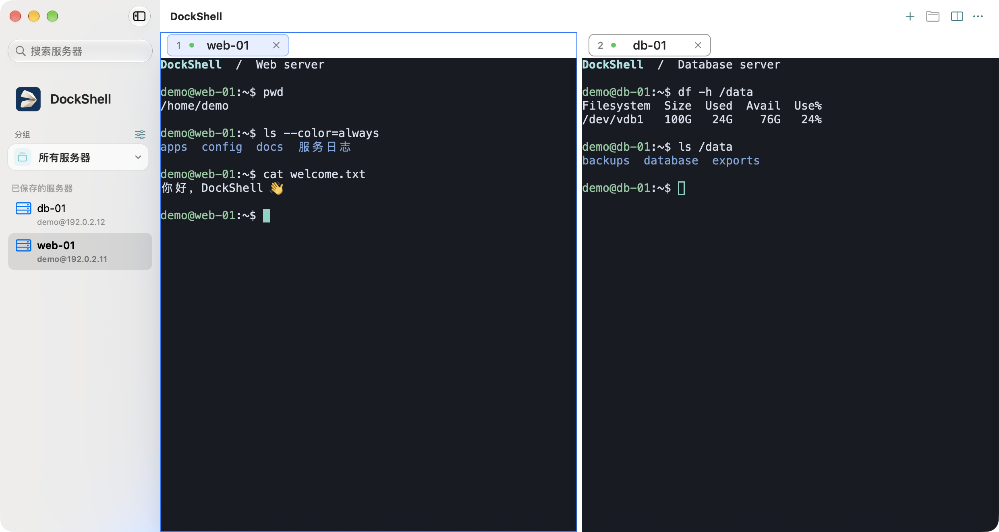

<p align="center">
  
</p>

<h1 align="center">DockShell</h1>

<p align="center">为 macOS 打造的原生 SSH 终端客户端</p>
<p align="center">多标签与分屏 · SFTP 文件传输 · 批量命令 · SSH / CSV 会话导入</p>

DockShell 将 SSH 会话、终端标签、分屏和远程文件面板集中在一个窗口中，支持简体中文与英文。

**v0.4.0** 新增 `~/.ssh/config` 导入和 CSV 批量创建，支持分组选择、预览编辑、勾选导入与同组同名跳过。[版本说明](Docs/ReleaseNotes/v0.4.0.md)

[下载 DMG](https://github.com/SunHarvey/dockshell/releases/latest) · [功能](#功能) · [界面](#界面) · [安装](#安装) · [使用](#使用) · [从源码运行](#从源码运行)

## 功能

| 功能 | 支持范围 |
|---|---|
| 会话管理 | 新建、编辑、删除、分组、搜索，双击会话连接 |
| SSH 配置导入 | 默认读取 `~/.ssh/config`，可选择文件；预览编辑后导入指定分组 |
| CSV 批量创建 | 文件或粘贴输入，支持密码、私钥、ssh-agent 三种认证配置；同组同名跳过 |
| SSH 认证 | 密码、文件或粘贴私钥、本机 ssh-agent；密码和私钥口令可保存到 Keychain |
| 多标签与分屏 | 标签编号、拖动排序、独立关闭；已有连接左右并列或上下堆叠，空间平均分配 |
| 终端 | 256 色、TrueColor、鼠标、窗口尺寸同步、中文与 emoji 显示 |
| SFTP | 右侧可收起面板，远程目录浏览、文件多选上传下载、进度、取消与传输队列 |
| 批量命令 | 独立命令栏，将单行命令发送到全部已连接 SSH 标签，显示排队与跳过明细 |
| 终端日志 | 默认记录，每连接保留最近 5 MB；容量可调，右键暂停、恢复或导出 UTF-8 文本 |
| 连接与信任 | 首次主机指纹确认、主机密钥变化拦截、心跳检测、断线提示与手动重连 |
| 本机 Shell | 使用当前用户默认交互式登录 Shell，从主目录启动 |
| 设置 | 字体、字号、三套主题、滚屏历史和日志设置，保存后立即作用于已打开终端 |

## 界面

截图使用演示会话与示例输出；工具栏等细节以当前版本为准。

### 多标签工作区



### 左右并列分屏



## 安装

- **运行目标：macOS 14 或更高版本。** 当前提供 **Apple Silicon / arm64** 安装包；macOS 14 实机仍待验证，暂不提供 Intel 安装包。
- 打开 [Releases](https://github.com/SunHarvey/dockshell/releases/latest)，在 **Assets** 下载 `DockShell-版本号-架构.dmg`，例如 **[DockShell-0.4.0-arm64.dmg](https://github.com/SunHarvey/dockshell/releases/download/v0.4.0/DockShell-0.4.0-arm64.dmg)**。
- 打开 DMG，将左侧 **DockShell.app** 拖到右侧 **Applications（应用程序）**，复制完成后推出磁盘映像，再从应用程序启动。

当前安装包采用 **ad-hoc 签名，尚未获得 Developer ID 签名和 Apple 公证**，首次启动可能被 macOS 拦截。分发状态及人工待验范围见 [分发说明](Docs/M6/分发准备.md) 与 [验收记录](Docs/M6/验收矩阵.md)。

如需核对下载文件，同时下载 Release 中的 `SHA256SUMS`，在下载目录执行：

```sh
shasum -a 256 -c SHA256SUMS
```

## 使用

### 创建与连接会话

点击 **＋ → 新建会话**，填写主机、端口、用户名和认证方式。保存后双击侧栏会话，或选中后按 **⌘T** 连接。首次连接时核对服务器的 SHA-256 主机指纹。

私钥可以选择外部文件或直接粘贴。外部文件仅保存引用；粘贴私钥会保存为仅当前用户可读的应用管理文件。私钥口令单独保存在 Keychain。支持已识别的 OpenSSH 与部分 PEM 私钥；PuTTY `.ppk` 需先转换。[认证与格式范围](Docs/M5/私钥Agent与连接恢复.md)

使用 ssh-agent 前，先在本机加载需要的私钥：

```sh
ssh-add ~/.ssh/id_rsa
ssh-add -l
```

随后选择 **SSH agent** 认证。DockShell 复用本机已有的 agent，不自动加载或解锁密钥。

### 导入 SSH 配置

选择 **＋ → 导入 SSH 配置…**，默认读取 `~/.ssh/config`，也可选择其他文件。默认目标分组为 `local-ssh-config`，支持选择已有分组或填写新名称。

预览中可编辑连接信息、勾选需要的会话；同组同名跳过，改名后可导入。`Host` 通配规则用于补全具体主机，`Include` 支持有界递归与文件通配。暂不支持的 `Match`、跳板机等配置会明确提示，避免误导入为直连。[完整支持范围](Docs/M12/SSH配置导入.md)

### CSV 批量创建

选择 **＋ → CSV 批量创建服务器…**，打开文件或粘贴内容，选择目标分组后点击 **预览服务器**。默认分组为 `csv-import`。

```csv
name,host,port,username,auth,key_path
web-01,192.0.2.11,22,root,agent,
app-01,192.0.2.12,2222,admin,password,
db-01,192.0.2.13,22,ubuntu,key,~/.ssh/id_ed25519
```

`auth` 使用 `agent`、`password` 或 `key`；端口留空时使用 22，私钥路径支持绝对路径和 `~/`。**CSV 不填写密码或私钥口令**，连接时再输入。预览可修改名称和连接信息，只有已勾选且有效的行会导入；同组及批内重名跳过并显示明细。

支持 UTF-8 CSV，最多 1000 台服务器、2 MB。含逗号的字段用双引号包围。导入不会自动连接，也不会覆盖已有会话。[格式说明](Docs/M12/CSV批量创建.md) · [示例文件](Examples/servers.csv)

### 标签、分屏与工具栏

- **＋**：新建、导入、连接会话及打开本机终端；**⌘N** 新建，**⌘T** 连接所选会话。
- **文件夹**：展开或收起当前标签的远程文件面板。
- **布局**：将全部已打开连接平均排成左右并列或上下堆叠，也可返回标签视图。
- **⋯**：设置、当前连接操作、手动重连与批量命令；悬停按钮可查看用途。

拖动标签调整顺序，编号始终从左到右自 1 开始。点击标签的 **×** 只关闭对应连接。分组管理位于侧栏“分组”标题右侧。

### SFTP 文件传输

打开远程文件面板后，双击目录进入，或在路径栏输入远程路径。**筛选当前目录**按名称筛选远程目录中的项目。

上传同名文件直接覆盖；重复下载会保留已有文件，新文件自动命名为 `文件名 (1).扩展名` 等。普通文件可多选排队，任务显示进度并可取消。服务器不支持安全替换时，同名上传会明确报错。

文件面板和传输使用独立连接，未保存的密码或口令可能需要再次输入。文件夹递归传输、断点续传与退出后恢复队列暂未实现。[SFTP 使用说明](Docs/M9/SFTP文件传输.md)

### 批量命令、日志与设置

通过 **⋯ → 批量执行命令** 展开命令栏，将单行命令发送到全部已连接的 SSH 标签，包括后台和分屏标签。等待认证、连接中和断线会话会跳过；“已排队”表示命令已进入本机发送队列。[批量命令说明](Docs/M11/批量命令.md)

SSH 与本机终端默认记录日志，每连接保留最近 **5 MB**，超限滚动删除旧内容。终端内右键可暂停、恢复或导出。vim 等备用屏幕内容会略过，仅记录进入、退出时间；服务器回显的敏感内容仍可能被记录。[终端日志说明](Docs/M10/终端日志接入与验收.md)

通过 **⋯ → 设置** 或 **⌘,** 调整字体、字号、主题、滚屏历史和日志容量，保存后立即生效。滚屏历史默认 **10000 行**；日志容量可设为 **1–100 MB**。

关闭全部远程标签后，可用 **＋ → 打开本机终端** 执行 `ls`、`top` 等本机命令，初始目录为用户主目录。

## 从源码运行

需要 **Swift 6、macOS SDK 与 Command Line Tools**。可使用 CLT 构建，无需完整 Xcode 或 Apple Account 登录。当前本机验证环境为 Swift 6.4 / SDK 27.0。

```sh
xcode-select --install   # 已安装命令行工具时跳过

git clone https://github.com/SunHarvey/dockshell.git
cd dockshell
sh Scripts/check-environment.sh
sh Scripts/run.sh zh-Hans
```

使用 `sh Scripts/run.sh en` 启动英文界面，或 `sh Scripts/run.sh` 跟随系统语言。重新构建前先用 **⌘Q** 退出旧应用。运行脚本负责资源打包与本地签名，生成 `Build/debug/DockShell.app`。

## 开发与验证

SwiftUI / AppKit、MVVM 分层、async/await / Actor；协议层通过接口隔离，配置使用系统 SQLite，密码和口令使用 Keychain。

| 检查 | 命令 |
|---|---|
| 构建应用 | `sh Scripts/build.sh` 或 `sh Scripts/build.sh release` |
| 默认回归与资源搬迁 | `sh Scripts/test.sh` |
| 原生界面 | `DOCKSHELL_UI_SMOKE=1 sh Scripts/test.sh` |
| SSH 配置导入 | `sh Scripts/test-session-import.sh` |
| CSV 批量创建 | `sh Scripts/test-csv-import.sh` |
| SSH / SFTP 隔离集成 | `sh Scripts/test-sftp.sh` |

其他专项与验收边界见 [开发记录](Docs/Development-History.md)。CI 对 main / PR 执行构建与验证；版本标签触发 Release 工作流，标题使用标签本身，DMG 直接附在 Assets。[GitHub Actions 说明](Docs/GitHub-Actions.md)

| 组件 | 版本 / 来源 |
|---|---|
| [SwiftTerm](https://github.com/migueldeicaza/SwiftTerm) | **1.19.0+dockshell.1**，本地 SPM 包；[来源与获批最小补丁](Vendor/SwiftTerm/UPSTREAM.md) |
| OpenSSH | macOS 系统工具，通过自有协议与 PTY 适配 |
| SQLite | macOS 系统库 |

第三方声明见 [ThirdPartyNotices](Packaging/ThirdPartyNotices.txt)。目录与完整文件索引见各功能文档；早期探针与品牌设计过程不属于应用运行依赖。

## 后续计划

文件夹递归传输、端口转发、跳板机、快速命令、Zmodem 与 Xshell 配置导入尚未实现。平台与人工待验项见 [验收记录](Docs/M6/验收矩阵.md)，历史里程碑保留在 [开发记录](Docs/Development-History.md)。
